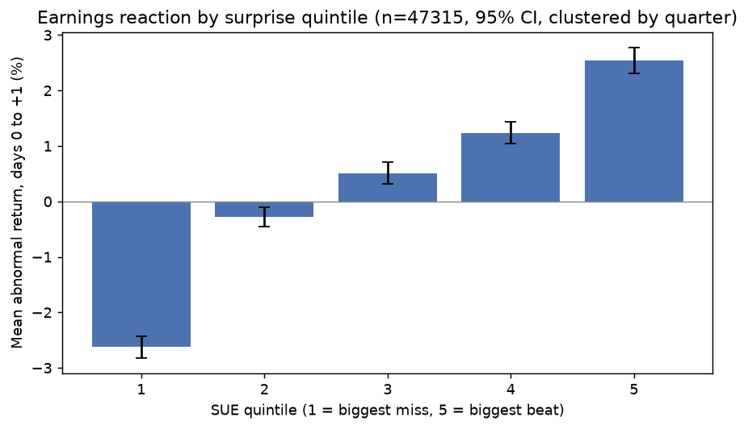
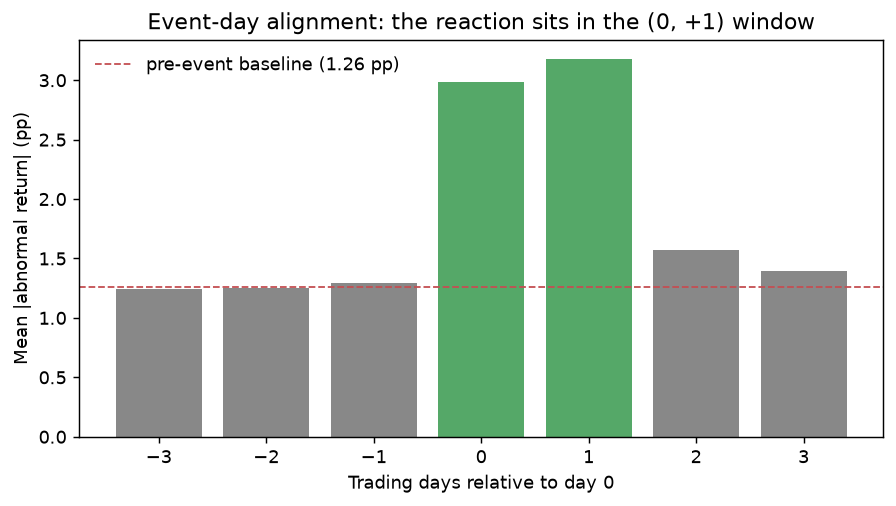
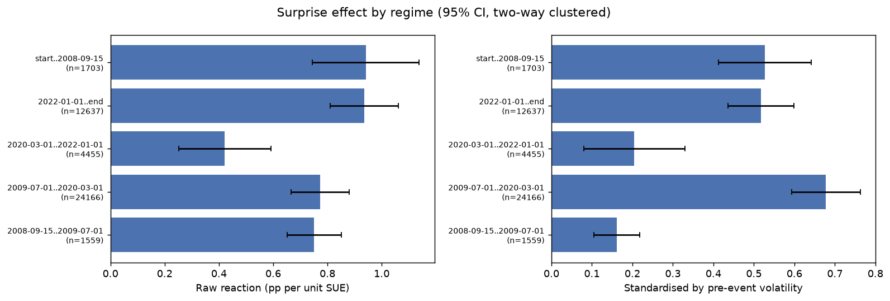
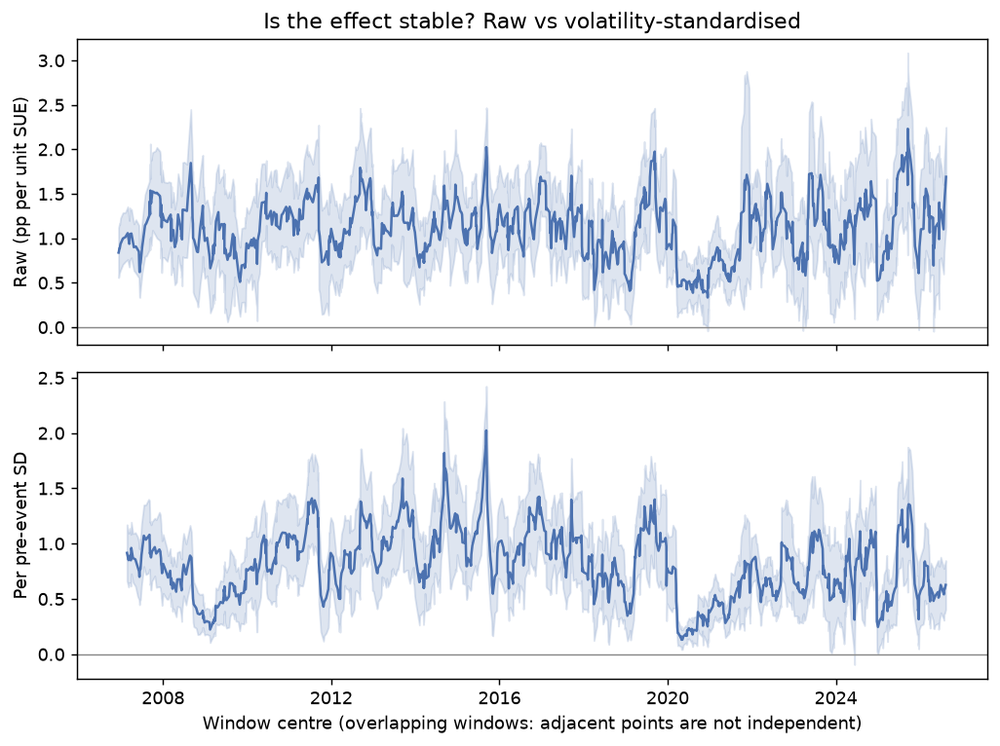
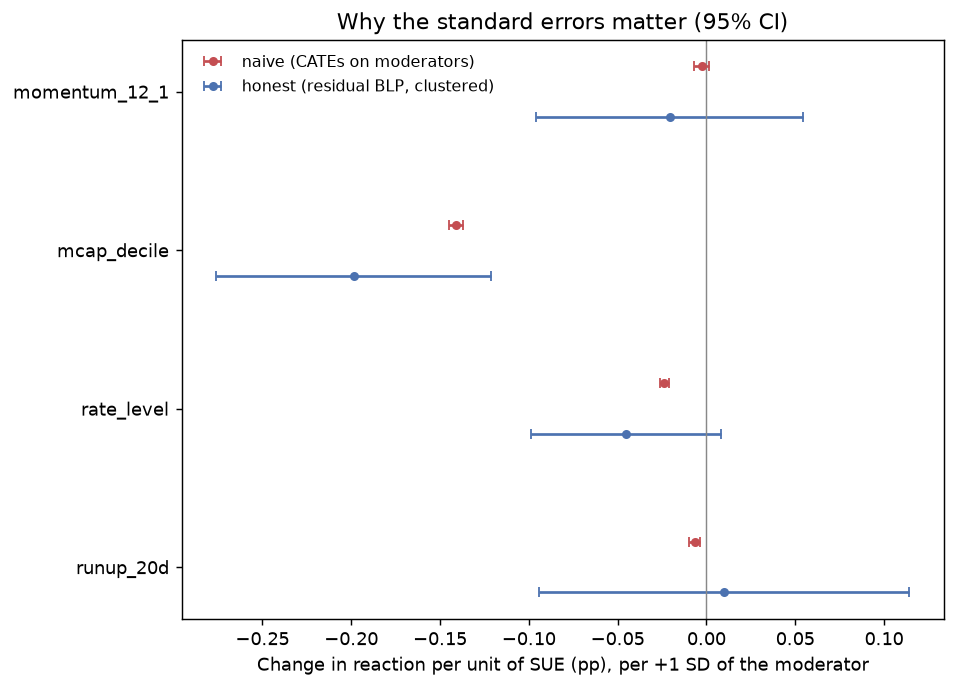
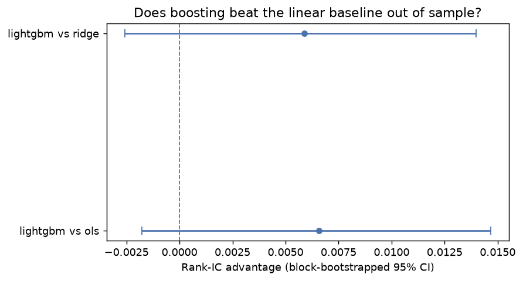
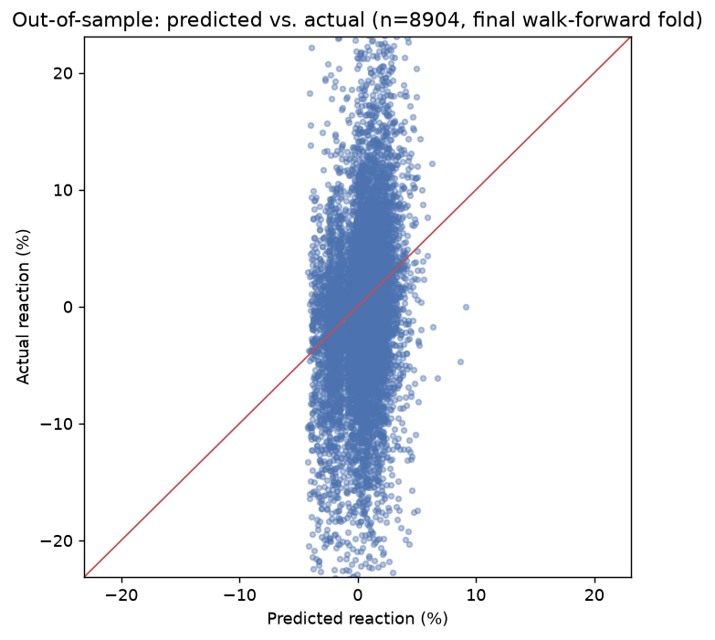
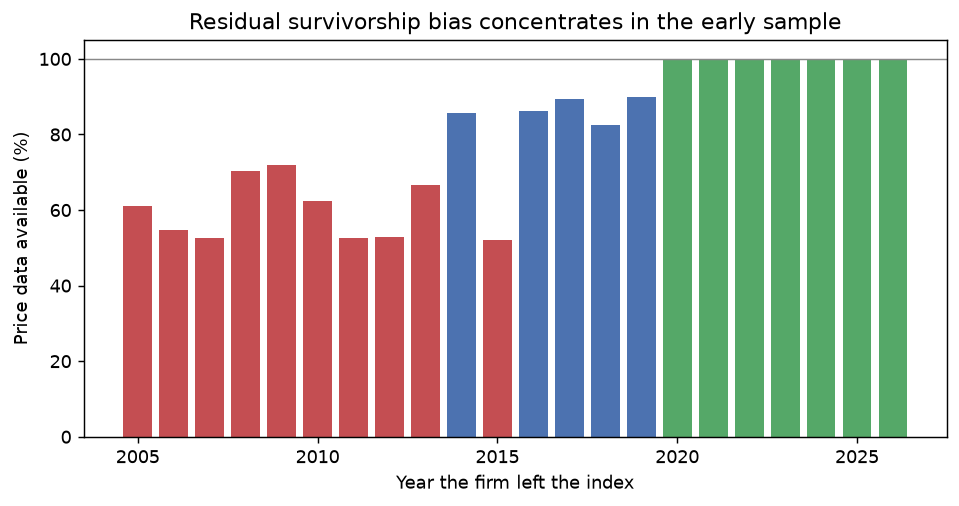
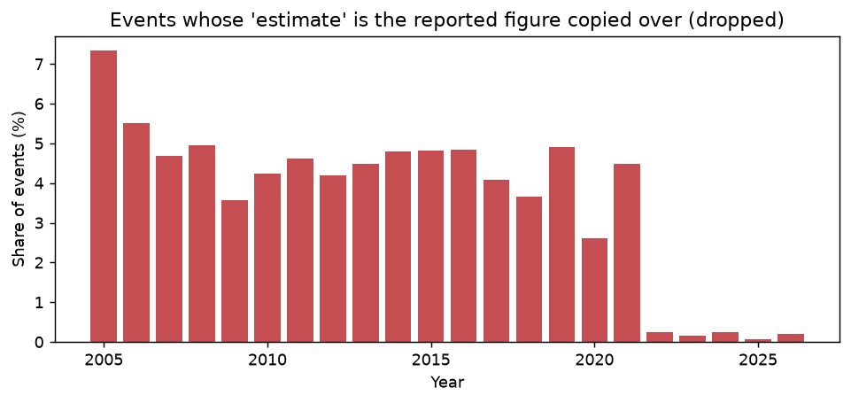

# Earnings Reaction Lab

Meta beats earnings and the stock falls 7%. Shopify beats by a similar margin the same
season and rises 5%. Same headline, opposite outcome.

This project asks why. It looks at **48,056 earnings announcements from 730 S&P 500
companies between 2006 and 2026** and measures how much a stock moves when a company beats
or misses what analysts expected, and what makes that move bigger or smaller.

---

## What I found

**1. Earnings surprises move prices, predictably on average.** A typical-sized beat moves
the stock about 0.8% over two days. The biggest misses average -2.6%, the biggest beats
+2.5%.

**2. The market cares much less during a crisis.** In the 2008 crash and again during
COVID, the same surprise moved a stock roughly a third as much as in calm periods. When
everyone is worried about the whole economy, one company's profit beat barely registers.

**3. Most of the patterns that looked interesting were not real.** An early version found
three factors that seemed to change the reaction. Measured properly, only one survived:
**larger companies react less**, probably because more analysts already cover them.

**4. Machine learning beats a simple model on accuracy, not on ranking.** A gradient-boosted
model explains about 25% more of the variation in reactions than linear regression (R² of
0.053 against 0.042), and that gap is statistically solid. At ranking stocks from best to
worst reaction, though, it is only marginally better. Either way, around 95% of why any
particular stock moved is something earnings numbers cannot capture.

> **[docs/FIXES-2026-09.md](docs/FIXES-2026-09.md)** lists 30 bugs I found in my own earlier
> version of this code, several of which changed the conclusions. It is probably the most
> useful file in the repository.

---

## The findings in detail

### Bigger surprises, bigger moves



Every announcement is sorted into five groups from biggest miss (1) to biggest beat (5).
The pattern is clean: the further from expectations, the larger the move.

"Surprise" here means how far the result was from the analyst forecast, scaled by how
much that company usually surprises by. A company that always lands within a cent of
forecast and misses by ten cents is a bigger surprise than one that routinely swings by a
dollar.

Three different statistical methods agree on the size of the effect: roughly **0.7 to 0.8
percentage points of stock move per unit of surprise**.

### The reaction takes two days



On an ordinary day a stock moves about 1.3% (up or down). On earnings day and the day
after, that jumps to about 3%. It takes two days because some companies report before the
market opens (the stock reacts the same day) and others after it closes (the stock reacts
the next morning). The data does not say which, so both days are counted.

This chart is also the proof that the biggest bug in the original version is fixed: it
had been measuring the reaction one day too late.

### During crises, earnings matter less



The right panel is the one to read. It adjusts for the fact that stocks are more volatile
in some periods than others, so the comparison is fair.

| Period | Reaction to the same surprise |
|---|---|
| Before the 2008 crisis | 0.53 |
| **2008 financial crisis** | **0.16** |
| 2009 to 2020 | 0.68 |
| **COVID** | **0.20** |
| 2022 onwards | 0.52 |

Both crises are low, every calm period is high. Two separate crises showing the same
thing is much stronger evidence than one would be. The periods were chosen in advance
from economic history, not picked to make the result look good.



### Most heterogeneity disappears under proper statistics



This is the most important chart methodologically. Both sets of error bars describe the
same estimates. The red ones come from a common shortcut; the blue ones from doing it
properly.

The shortcut made the results look **up to 33 times more certain than they were**. Under
it, three factors looked significant. Done properly, one survived: company size. The
"stock already ran up before earnings" effect that looked like the headline finding
turned out to be noise.

Why the shortcut fails, briefly: it treats the model's own smoothed predictions as if
they were real observations, so it ends up measuring how smooth the model is rather than
how uncertain the data is.

### Prediction: machine learning wins on accuracy, ties on ranking

| Model | Variance explained (R²) | Ranking accuracy (rank IC) |
|---|---|---|
| Linear regression | 0.042 | 0.235 |
| Ridge regression | 0.042 | 0.235 |
| Gradient boosting | **0.053** | 0.241 |

All three were tested on the same 8,904 announcements, none of which they saw during
training.

On **accuracy**, boosting is clearly better: it explains about 25% more of the variation
than linear regression, and a paired test comparing the two models' errors event by event
rules out chance (p < 0.001). The likely source is non-linear effects a straight-line
model cannot represent, though this project does not isolate which ones.

On **ranking** (sorting stocks from best to worst reaction), the gain is about 3% and
the confidence interval includes zero:



So the honest summary is that machine learning makes the predicted size of a move more
accurate, but is not demonstrably better at telling you which stocks will move most.



The models predict moves of a few percent while actual moves range up to 20%. Most of
what drives an individual stock's reaction (the guidance wording, one weak division,
positioning) is not in the numbers.

---

## What the data cannot tell you

Every dataset has gaps. These are the ones that matter, with numbers attached.

**Some failed companies are missing.** Of 465 firms that left the S&P 500 during the
period, price data exists for 355 (76%). The gaps are mostly before 2015, so the 2008
crisis comparison is the result most affected.



**Some analyst forecasts were fake.** Where no real forecast existed, the data provider
copied the actual result into the forecast field, making it look like a perfect zero
surprise. 1,892 of these (3.5%) were found and removed.



**Stock splits had to be fixed by hand.** The price data was not adjusted for stock
splits, so a 2-for-1 split looked like a 50% crash. These were corrected; 38 unexplained
jumps remain, affecting 10 of 48,056 events.

**Every stock is treated as moving one-for-one with the market.** In reality some stocks
swing harder than the market and some less. This is the biggest simplification left in
the analysis.

---

## Technical design

The rest of this README is for readers who want to see how the analysis is built. Each
method appears only where its assumptions earn their place, and the line between what is
descriptive, causal and predictive is kept explicit throughout.

### Methods, and why each one

| Question | Method | Why this tool |
|---|---|---|
| What is the average reaction, and is the data right? | Event study, cluster-robust OLS | Establishes the stylised fact and surfaces upstream bugs before any estimator is trusted |
| Effect of surprise size with many controls | Post-double-selection lasso (Belloni, Chernozhukov & Hansen 2014) | Valid inference on one coefficient under high-dimensional controls; theory-driven plug-in penalty |
| Which conditions moderate the reaction, without pre-specifying them | Causal forest (`CausalForestDML`) with a residual-based best linear projection | Non-parametric heterogeneity discovery, with inference that does not treat fitted effects as data |
| Is the effect stable over 20 years | Chow-type Wald test, rolling-window estimation, volatility standardisation | A pooled coefficient across regimes is only meaningful if the relationship is stable |
| Can the reaction be predicted | LightGBM tuned with Optuna, against OLS and Ridge | ML has to beat a linear baseline on the same folds and metrics to justify its complexity |
| Is one model genuinely better | Paired Diebold-Mariano loss test, quarter-block bootstrap of rank IC | Model errors are correlated, so the comparison has to be paired and respect clustering |

### The choices that matter

**Double selection, not naive control selection.** Selecting controls and then running
inference on the selected model invalidates the standard errors (the post-selection
inference problem). Double selection picks controls from both the outcome and the
treatment equations, which restores valid inference on the surprise coefficient. The
penalty is the plug-in value rather than a cross-validated lambda, which would over-select.

**Two-way clustered standard errors.** A firm's quarters are correlated, and every firm
reporting in the same week shares macro shocks. Errors are clustered by firm and by
quarter (Cameron, Gelbach & Miller), with the covariance projected to the nearest
positive semi-definite matrix.

**Honest heterogeneity inference.** Under the partially linear model
`Y = θ(X)·T + g(X,W) + ε`, Robinson residualisation gives `Y_res = θ(X)·T_res + ε`. The
best linear projection of `θ(X)` on standardised moderators `Z` is therefore the regression
`Y_res = a·T_res + Σ b_j·(T_res × Z_j) + u`, estimated on the forest's cross-fitted
residuals with firm-clustered errors. The common shortcut, regressing fitted CATEs on `Z`,
is kept in the output only for contrast: it understates standard errors by up to 33x here.

**Leakage-proof validation.** Walk-forward cross-validation with a 35-day purge, so no
training event's outcome window overlaps the test period. Out-of-sample R² is benchmarked
against the training mean, the only benchmark available at prediction time, rather than
the test fold's own mean.

**Standardised surprise.** Raw surprise-percent explodes for near-zero EPS denominators.
SUE scales each surprise by the firm's own past surprise volatility, using prior quarters
only, and is winsorised against quantiles computed from earlier events so no future
information leaks into the clipping threshold.

### Assumptions, stated rather than assumed

The surprise is not randomly assigned, so a causal reading rests on **conditional
unconfoundedness**: given the controls, the surprise is as good as random with respect to
the reaction. That is a strong assumption. Plausible confounders such as guidance tone,
options positioning and analyst dispersion are only partly captured, so where it is
doubtful the estimates are conditional associations, not clean causal effects.

The inference theory behind causal forests assumes independent observations. A firm by
time panel violates that, so valid use relies on weak temporal dependence; cross-fitting
by ticker and firm-clustered errors on every reported summary keep that dependence from
being ignored.

### Engineering

**Point-in-time throughout.** Index membership is rebuilt from the constituent change log
so a firm is in the sample only while it was actually in the S&P 500. Fundamentals are
shifted forward by a 90-day publication lag, because the vendor's date is the fiscal period
end, not the filing date.

**Data that verifies itself.** The pipeline does not assume its corrections worked; it
measures them. Split adjustment checks each split against the observed price before
applying it, after finding that the vendor back-adjusts some symbols and not others,
which meant a blind correction was corrupting 396 already-clean series. Every run reports
its own residual contamination: event-day alignment, survivorship coverage by era,
placeholder analyst estimates, unexplained price jumps and how many events they touch.

**Reproducible stages.** Harvest, panel, inference, predict, plots and export each write
their outputs to disk, so any stage can be re-run alone. A rate-limited, cached, resumable
API client makes the multi-thousand-call harvest restartable at no cost. Run manifests let the
export detect when its tables come from two different runs and flag the mismatch instead of
presenting them as one set of results.

**Estimators checked against known answers.** Each estimator is validated on simulated
data where the true effect is known, including the case where it must *fail* to find a
break or a moderator that is not there.

All of this is documented with its reproduction in
[docs/FIXES-2026-09.md](docs/FIXES-2026-09.md).

---

## Running it

You need Python 3.10+ and a [Financial Modeling Prep](https://financialmodelingprep.com)
API key (the Premium plan covers everything).

```
git clone https://github.com/ChistoOleg/earnings-reaction-lab.git
cd earnings-reaction-lab
python -m venv .venv
source .venv/bin/activate        # Windows: .venv\Scripts\activate.bat
pip install -r requirements.txt
pip install -e .
cp .env.example .env             # then add your ERL_FMP_API_KEY
python -m erl.pipeline all --universe pilot    # 30 companies, a few minutes
python -m erl.pipeline all --universe sp500    # full run, under an hour
```

Results land in `data/processed/`, with every figure and table collected in
`results.xlsx` and `results.md`. Full setup notes are in [docs/SETUP.md](docs/SETUP.md).

---

## Repository layout

```
src/erl/
  config.py            typed settings (ERL_ env prefix), data directories, benchmarks
  fmp.py               rate-limited, cached, resumable API client
  universe.py          point-in-time S&P 500 membership from the change log
  harvest/             earnings, prices, fundamentals, splits (split adjustment applied locally)
  events/              abnormal returns, event windows, features, panel with leakage guards
  inference/           event study, double lasso, causal forest, stability tests
  predict/             purged walk-forward CV, LightGBM with SHAP, baselines, paired tests
  text/                transcript embeddings with leakage-safe PCA (built, not yet run)
  report.py            the 16 figures
  export.py            consolidates every result into results.xlsx and results.md
  pipeline.py          runs harvest, panel, inference, predict, plots, export in order
docs/                  setup guide and the bug log
reports/               the figures used in this README
notebooks/             one walkthrough per analysis, jupytext percent format
```

---

## License

MIT, see `LICENSE`.
